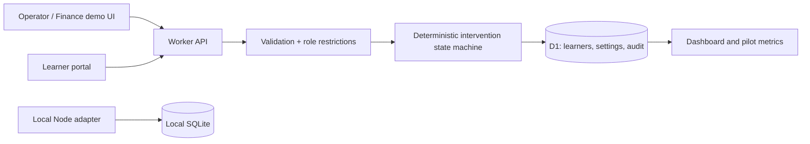
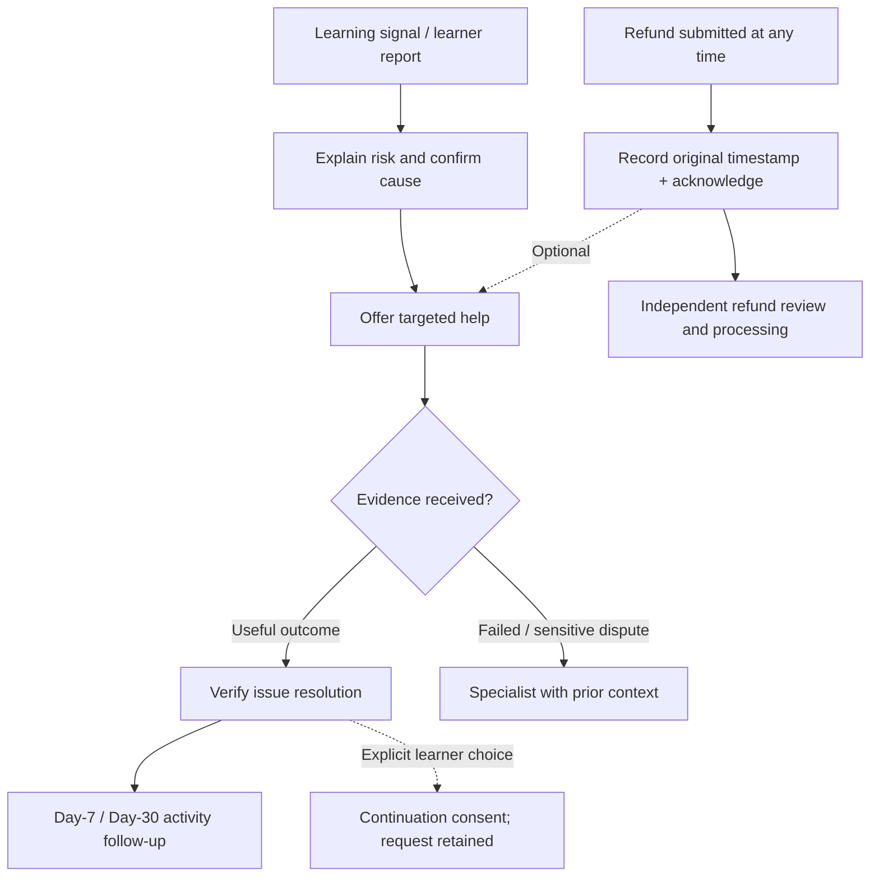

# Project FIRST-14 | A learner retention proposal for Scaler

I propose three changes: clarify course expectations before payment, help learners complete their first assessed task by Day 7, and fix early problems before they lead to refund requests.

Rescue is my prototype for the third change. For example, when a learner struggles with an early assignment, the demo offers a practice exercise and routes the case to a specialist if the learner still needs help. Learners can request a refund at any point in the demo, and help is optional.

The case gives 1,000 monthly enrolments and a roughly 15% request rate. I would test whether that rate moves toward 12% while more learners stay active at Day 30. Demo records and outcomes are synthetic.

## Three-minute walkthrough

1. Start with the case baseline and explain the 12% pilot target.
2. Open Aarav’s case. Show why he was flagged, offer the practice task, and enter 16 as the learner. Return to the dashboard to show the recorded result.
3. Open Vikram’s refund request to show that help is optional. Then show how Finance reviews a request and how Meera can choose to continue while her original request remains on record.
4. Route Ananya’s expectations mismatch to Sales. Close with the two pilot outcomes: in-window refund requests and active learning at Day 30.

## Run locally

Requires Node 20+ and Python 3.12+. Run npm ci first to install the PostgreSQL driver. No paid AI API key is required.

```sh
npm run dev
# http://localhost:4173
npm test
npm run build
node scripts/reset.mjs
```

The local server stores records in SQLite under `.local/demo.sqlite`. The first state request seeds 1,000 learners and exactly 150 unique refund requesters. Reset affects only the local demo. Hosted records use Cloudflare D1, provisioned through Sites. Reloads preserve changes.

## What works

* **Command center:** cohort/program filters, live counts, request rates, risk-day chart, reason distribution and priority drill-down.
* **Risk intelligence:** editable rule weights, transparent score components, program-specific deadlines. Scores are illustrative, never calibrated probabilities.
* **Resolution:** seven cause-specific playbooks. Academic and doubt exercises validate answers; catch-up, schedule and access outcomes use explicit simulated evidence. Failed attempts escalate. Sales/policy disputes require a human.
* **Refund operations:** immutable original timestamp; independent acknowledgement; documented, role-restricted state transitions; repeat-request tracking; explicit voluntary continuation; Day-7/30 follow-up dates and simulated activity.
* **Case workspace:** team assignments, previous actions and outcomes, due dates, overdue counts, human-help routing.
* **Learner portal:** six scenario selectors, issue reporting, guidance, responses, escalation and refund submission without mandatory assistance.
* **Pilot and impact:** treatment/control comparisons from current records, editable cost assumptions, proposed request-rate target and validation guardrails.

Every operational action calls the server and saves a learner record. Optimistic revision checks reject stale writes. An atomic database batch updates the learner and appends its audit entry. User-supplied text is escaped in HTML, SQL uses bound parameters, POSTs reject cross-origin browser requests, and settings and state transitions are validated server-side.

## Architecture



Pragmatic stack choice: plain JavaScript, a responsive HTML/CSS application, a Cloudflare Worker and D1. This keeps the core portable and deployable without a paid model. The build bundles the three source modules into one Worker. It uses runtime validation, rather than TypeScript; shared types and component extraction are production roadmap items.

## Workflow



## Data model and API

`learners(id, revision, payload)` stores one synthetic learner aggregate with signals, interventions, request history and events. `settings(id, payload)` stores policy-day and score configuration. `audit(id, learner_id, at, action, detail)` stores appended action records. Aggregate JSON simplifies the prototype; production should normalize refund requests, policy versions, intervention attempts and experiment assignments.

`GET /api/state` seeds once and returns the workspace. `POST /api/action` requires id, expected revision, action and data. `POST /api/settings` validates configuration. `X-Demo-Role` selects Operator, Finance or Learner. This is explicitly **not secure production authorization**: anyone with demo access can switch roles and learner identities. The hosted site's owner-only sign-in is the outer access boundary. Do not make this demo public with real data.

## Evidence and assumptions

Reviewed 18 November 2026: [India-facing Scaler terms](https://fp.scaler.com/terms/) and [Scaler's policy explanation](https://www.scaler.com/topics/is-scaler-legit/) describe a 14-day window from the first class, including meet-and-greet. [Other regional terms](https://www.scaler.com/terms/) include different fee language. Applicable signed program terms must govern actual eligibility. The prototype makes no refund eligibility, bank-transfer or financing decisions.

The assignment gives 1,000 monthly enrolments and about 15% requesting refunds, or roughly 150. The demo seeds exactly 150 unique requesters. A 12% target means 120 requesters / 30 fewer requests; it is a hypothesis, never an achieved result. The seed's uniform cause distribution is an assumption, editable in `src/domain.mjs` (`causes` and seed cause selection). Policy windows, risk weights and the target are editable in the UI. The demo clock is fixed at 18 Nov 2026 for repeatable deadlines; action audit timestamps use actual server time.

Day-30 active status in seed records is synthetic future follow-up data, not observed activity from the current November cohort. Deterministic treatment assignment is confounded with cohort and is not a real randomized experiment. No causal lift is claimed.

## Tests

`npm test` checks baseline cardinality, evidence-based academic resolution, failed escalation, refund independence and timestamp preservation, specialist boundaries, Finance transitions, learner-role restrictions, and an API-to-SQLite persistence/audit/concurrency/origin integration flow. CI runs tests, build and Worker syntax verification.

## Deployment

The tracked `.openai/hosting.json` identifies the private Sites project and D1 binding. Sites publishes the pushed source with `dist/server/index.js`, hosting metadata and the SQL migration in `drizzle/`. The provider applies migrations before running the Worker. There are no secrets in this repository.

For Vercel, follow [the deployment guide](VERCEL.md). The included API handler uses managed PostgreSQL.

Public source: https://github.com/Milindsen/scaler-refund-rescue-engine

## Known prototype limits

No LMS, CRM, email, payment or financing integration. No LLM or external AI classification is represented as working. Access checks, case assignments, attendance, workload agreements and retention evidence are simulations. There is no scheduler sending follow-up messages. Support-time, complaint and cost telemetry are not collected; the analytics panel labels these as future guardrails. Global settings edits do not yet have policy-version history. Seeding retries missing IDs if interrupted; hosted migration and reset operations still need an administrative lifecycle before multi-user production. No offline mode or real user authentication. No automated browser test runner is bundled; manual browser verification is recorded separately.

## Production roadmap

1. Replace demo identities and role headers with SSO, tenant boundaries and enrolment-level authorization; normalize records and snapshot approved policy versions.
2. Integrate LMS attendance/practice and CRM support events with idempotent ingestion, consent, data minimization and retention controls.
3. Add verified playbook content, SLA queues, notifications and scheduled follow-ups; instrument complaints, resolution time and handling costs.
4. Run a concurrent randomized pilot within program/cohort strata. Pre-register request-rate and Day-30 outcomes, use intention-to-treat analysis and confidence intervals, and monitor refund delays and negative feedback.
5. Add monitoring, rate limits, backup/restore testing, accessibility audit, load tests and security review before real learner use.

